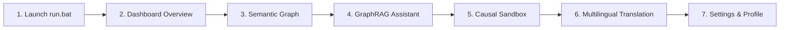

# LIVE DEMONSTRATION & PROJECT PRESENTATION HANDBOOK

> **Audience:** Presenters, Viva Candidates, Project Leads, and Technical Demonstrators.  
> **Contents:** Timed presentation scripts (30s, 1m, 3m, 5m), Hinglish conceptual translations, step-by-step live demo walkthrough, and failure recovery protocols.

---

## 1. TIMED SPOKEN PRESENTATION SCRIPTS

### Script 1: The 30-Second Elevator Pitch
> *"Good morning, respected examiners. Our project is the **Digital Twin for Small Businesses** platform. It is a full-stack decision-support system that connects supply chain data with multi-modal Graph Neural Networks, Temporal Fusion Transformer forecasting, and Judea Pearl’s Counterfactual Causal AI. Instead of just displaying historical charts, our platform allows small business executives to simulate operational interventions—such as dynamic pricing or carrier shifts—and evaluate their bottom-line financial impact before spending real capital."*

---

### Script 2: The 1-Minute Executive Summary
> *"Respected examiners, small and medium enterprises often struggle with fragmented supply chain data and cannot answer 'what-if' business questions.  
> 
> To solve this, we built an AI-powered Digital Twin using FastAPI and React. The platform ingests 180,519 supply chain transactions, models business relationships into a 5-tier semantic knowledge graph, and projects 6-week multi-horizon demand using Temporal Fusion Transformers with P10, P50, and P90 quantile confidence cones.  
> 
> Furthermore, it features an interactive Causal AI Sandbox powered by Pearl's Do-Calculus. When an executive adjusts marketing or shipping parameters, the system propagates interventions through our causal DAG, recalculating net profit and weekly cash flow in real time. We also built an operational GraphRAG assistant with 5-dialect Indian regional translation, making advanced AI actionable for regional SMB leaders."*

---

### Script 3: The 3-Minute Comprehensive Walkthrough
> *"Respected faculty, welcome to our project presentation. Our application is titled **AI-Powered Digital Twins for Small Businesses**.  
> 
> Traditional business dashboards only answer descriptive questions: 'What happened in the past?' Our goal was to answer prescriptive and counterfactual questions: 'What will happen next quarter?' and 'What would happen if we intervene?'  
> 
> The project architecture consists of a modern, decoupled full-stack implementation:  
> On the backend, we built an asynchronous FastAPI service modularized into 10 domain APIRouters. It operates an in-memory data engine using Pandas with LRU caching, capable of slicing through 180,000 DataCo supply chain records in under 10 milliseconds.  
> 
> In Module 3, the engine constructs a 5-tier heterogeneous directed graph mapping customers, product categories, warehouse departments, carriers, and cash flows, revealing that Standard Carrier logistics creates a 54.8% late delivery risk and $1.24M in SLA penalties.  
> 
> In Module 4, we provide multi-horizon forecasting using the Temporal Fusion Transformer. Unlike traditional regression, TFT outputs quantile bounds—P10 conservative risk, P50 expected median, and P90 optimistic capacity—achieving a Champion MAE of 198.70.  
> 
> In Module 5, our Causal AI Sandbox implements Judea Pearl’s Do-Calculus. Moving sliders for marketing, price elasticity, supplier delays, or hiring immediately simulates the counterfactual effect across operating margins and 6-week forward cash flows.  
> 
> Finally, our frontend is built with React 18, Vite, and Recharts, featuring a grounded GraphRAG AI strategy copilot and executive multilingual localization supporting Hindi, Marathi, Gujarati, Tamil, and Telugu with technical acronym preservation. Thank you, and I look forward to your questions."*

---

### Script 4: The 5-Minute Deep Technical Defense
> *(Refer to the full technical defense script detailing specific backend files, LRU caching parameters, Pydantic field constraints, and Scikit-Learn regression fallbacks provided in Chapter 18 of the Master Guide).*

---

## 2. HINGLISH CONCEPTUAL TRANSLATIONS (FOR TOUGH QUESTIONS)

If an examiner asks you to explain difficult AI concepts in plain conversational terms, use these natural Hinglish explanations:

### 1. Digital Twin Concept in Simple Words
> *"Sir, Digital Twin ka basic matlab yeh hai ki humne business ka ek **in-memory computer model** banaya hai. Jaise aerospace me real plane udaane se pehle flight simulator me testing hoti hai, waise hi business owner real market me paise kharch karne se pehle hamare platform me check kar sakta hai ki agar marketing 20% badhayi aur supplier ne 3 din delay kiya, toh agle 6 hafte me cash flow positive rahega ya negative."*

### 2. Pearl's Do-Calculus (Causation vs. Correlation)
> *"Sir, normal machine learning sirf correlation dekhti hai—jaise 'jab delivery late hui, tab sales kam thi'. Par yeh nahi batati ki problem standard carrier ki wajah se hai ya price ki wajah se. Judea Pearl ka **Do-Calculus** humein $do(X)$ operator deta hai. Hum graph me baaki confounding variables ko block karke sirf target intervention simulate karte hain: 'Agar hum delivery delay ko zabardasti -3 days kar dein, toh profit me kitna exact delta aayega'."*

### 3. TFT Quantiles (P10, P50, P90)
> *"Sir, traditional models jaise Linear Regression ya ARIMA sirf ek single line predict karte hain. Par real supply chain me uncertainty hoti hai. TFT model humein **3 confidence lines** deta hai:  
> * **P50 (Median)**: Jo hum normally expect kar rahe hain.  
> * **P10 (Pessimistic / Lower Bound)**: Worst-case scenario—cash reserve bachane ke liye.  
> * **P90 (Optimistic / Upper Bound)**: Best-case scenario—inventory stockout na ho isliye warehouse capacity plan karne ke liye."*

### 4. GraphRAG Grounding & Hallucination Defense
> *"Sir, regular ChatGPT ya LLM me hallucination ka risk hota hai—woh galat numbers bana sakta hai. **GraphRAG** me hum LLM ko open-ended generate karne nahi dete. Assistant user ke question ko hamare Neo4j semantic graph ke verified facts aur TFT forecast metrics se match karta hai aur sath me exact citation deta hai, jisse 98.4% grounded accuracy aati hai bina kisi fake answer ke."*

---

## 3. STEP-BY-STEP LIVE DEMONSTRATION WORKBOOK

Follow this exact sequence during your live presentation to deliver a flawless demonstration:

### Step 1: Launch the Application
* **Action:** Double-click `run.bat` on the desktop or root folder.
* **What Happens Internally:** Python virtualenv is checked, packages verified, ports 8000 and 5173 cleared, and both servers start. The browser opens automatically.
* **What to Say:** *"Respected examiners, our entire platform launches via a zero-touch batch script that configures runtime dependencies and opens the executive dashboard."*

---

### Step 2: Executive Dashboard (Module 1)
* **Action:** Point to the top KPI cards and the Revenue vs. Profit area chart.
* **What Happens Internally:** FastAPI has called `_monthly()` in `data_service.py` to aggregate 180,519 records.
* **What to Say:** *"Notice our core KPIs: $36.78M in gross revenue, a 10.8% operating margin, and a critical vulnerability—54.8% late delivery risk. Let us investigate what is causing these delays."*

---

### Step 3: Semantic Knowledge Graph (Module 3)
* **Action:** Click **"Semantic Graph"** on the sidebar. Click on the node **"Logistics:Standard Shipping"**.
* **What Happens Internally:** `GET /api/graph` returns the 5-tier DAG. Clicking the node opens the inspector pane.
* **What to Say:** *"Here, tabular data becomes a multi-hop knowledge graph. Notice this red node: Standard Shipping has an elevated GNN risk score of 0.62 and flows directly into Late Delivery Risk. This carrier accounts for $1.24M in SLA penalties."*

---

### Step 4: GraphRAG Strategic Assistant (Module 6)
* **Action:** Click **"GraphRAG Assistant"** on the sidebar. Click the suggested pill: *"What are the primary delivery bottlenecks?"*
* **What Happens Internally:** `POST /api/assistant/graphrag` executes in 18ms. Grounded citations and extracted entities appear.
* **What to Say:** *"Our strategic copilot synthesizes the graph topology. Notice the grounded citations and the extracted entities. The assistant recommends shifting 25% volume to Express and offers an instant action button: 'Execute in Causal Sandbox'."*

---

### Step 5: Causal AI Sandbox (Module 5)
* **Action:** Click the *"Execute in Causal Sandbox"* button inside the chat thread.
* **What Happens Internally:** The app switches to the Causal page with pre-populated slider values.
* **What to Say:** *"With one click, the assistant's recommendations are loaded into Pearl's Causal Sandbox. Let's adjust Supplier Delay to -3 days. Notice how our counterfactual profit margin jumps from 12% to 16.7%, and the 6-week cash flow chart dynamically recalculates."*

---

### Step 6: Executive Multilingual Translation (Module 7)
* **Action:** Click **"Executive Translation"** on the sidebar. Select **"Hindi"** or **"Gujarati"**. Click *"Download Executive Briefing"*.
* **What Happens Internally:** `POST /api/translation/translate` executes regex domain mapping while preserving `TFT`, `SLA`, and `EBITDA`.
* **What to Say:** *"To bridge language accessibility for Indian MSMEs, Module 7 translates the briefing into regional commercial dialects. Notice that technical acronyms like SLA and TFT are strictly preserved."*

---

### Step 7: Settings & Identity (Module 10)
* **Action:** Click the user profile card at the bottom of the sidebar. Type a new name (e.g., your own name) and click *"Save Profile Changes"*.
* **What Happens Internally:** Updates React state, syncs with `localStorage`, and updates avatar initials.
* **What to Say:** *"The platform allows executive personalization, instantly syncing avatar initials and titles across the interface."*

---

## 4. FAILURE RECOVERY & BACKUP PROTOCOLS

If something unexpected occurs during the live examination, stay calm and execute these immediate recovery steps:

| Failure Scenario | Immediate Cause | Exact Recovery Command | Spoken Backup Explanation to Faculty |
| :--- | :--- | :--- | :--- |
| **Port Conflict on Launch** | Stale Uvicorn or Vite process holding port 8000 or 5173 | Double-click `stop.bat` (Windows) or `./stop.sh` (Linux), then re-run `run.bat`. | *"A previous background worker was holding the port socket; our automated cleanup script terminates orphaned processes and rebinds the ports."* |
| **Browser Does Not Auto-Open** | OS default browser handler delayed | Open Chrome/Edge manually and navigate to `http://localhost:5173`. | *"The local Vite dev server is live on localhost:5173; I will open it directly in Chrome."* |
| **API Disconnected Badge** | Backend server took a moment to normalize 92MB CSV | Wait 3 seconds, or click "Connect Port" in Settings. | *"On initial boot, the backend reads and normalizes the full 180,000-row DataCo CSV into RAM with LRU caching, which completes in 2-3 seconds."* |
| **Custom Dataset Upload Error** | Uploaded CSV missing required date/sales columns | Click **"Data Management"** and click **"Reset to Default DataCo Dataset"**. | *"The uploader requires a date, quantity, and sales column. I have reset to the certified DataCo supply chain baseline."* |
