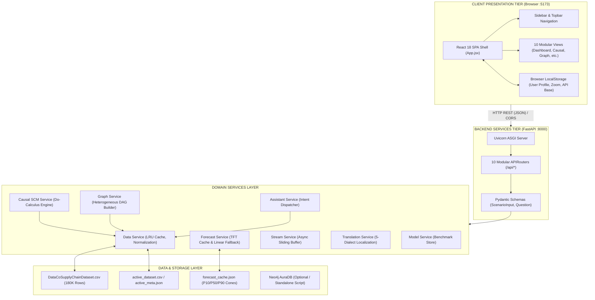
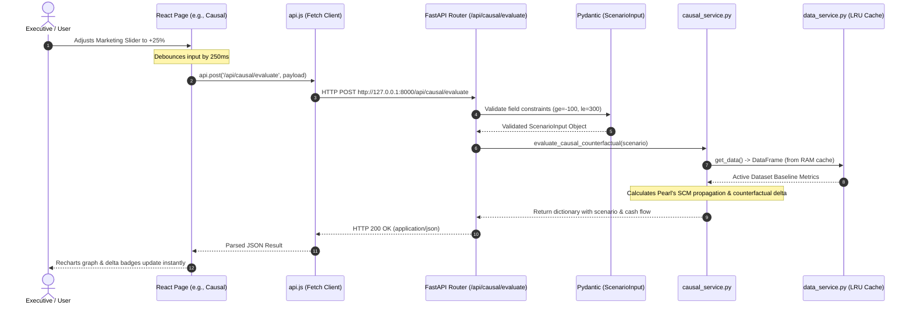
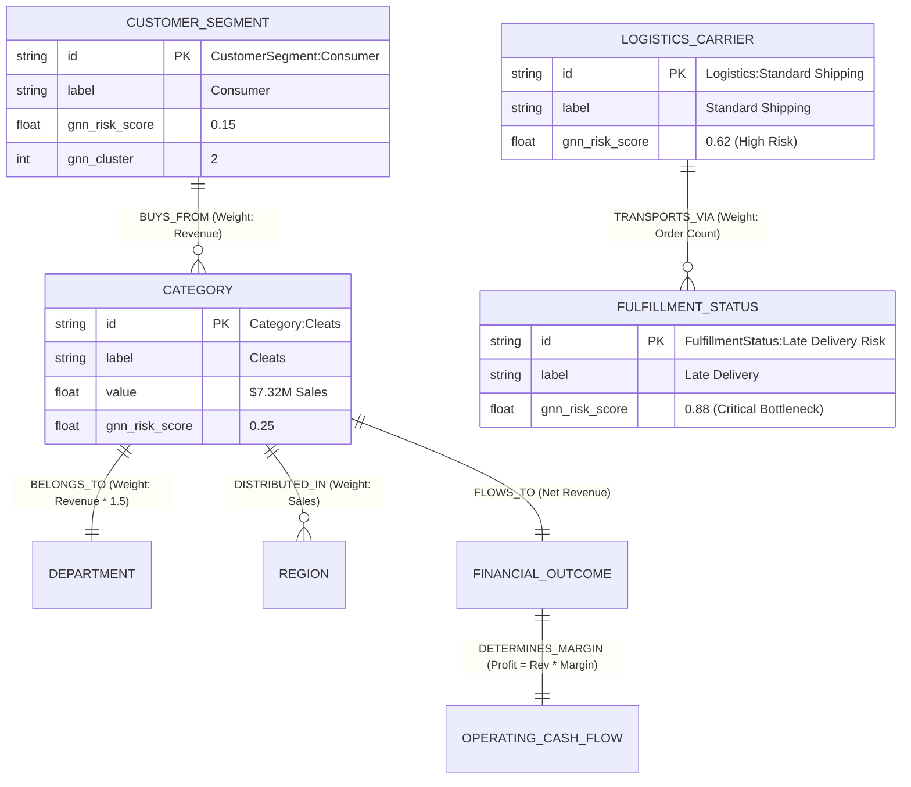
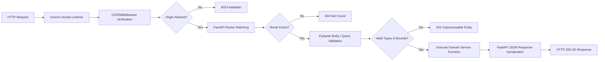
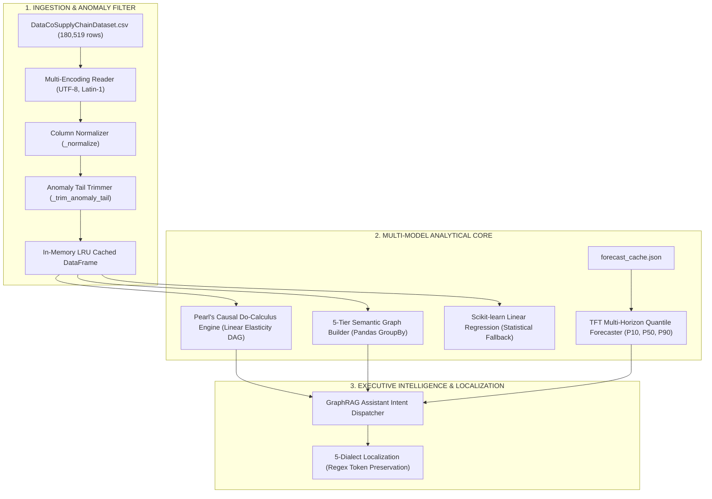
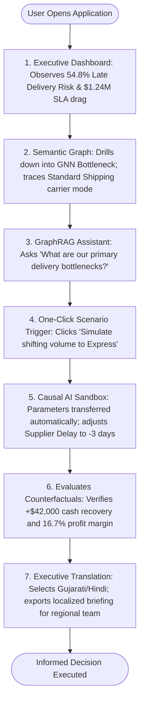
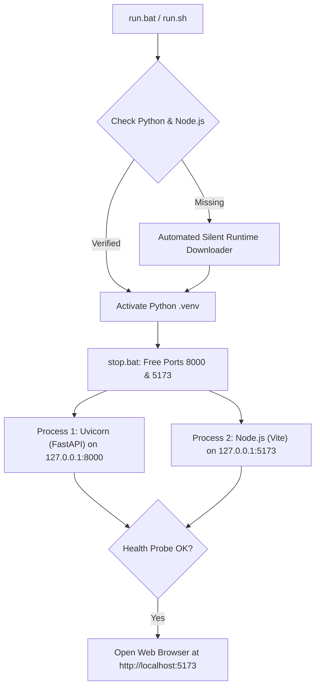

# SYSTEM ARCHITECTURE & DATA FLOW SPECIFICATION

> **Scope:** Architectural blueprint reconstructed strictly from the codebase implementation.  
> **Diagrams:** High-level system topology, frontend-backend communications, data relationships, API lifecycle, AI pipelines, user journeys, and process deployment.

---

## 1. ARCHITECTURAL OVERVIEW

The **Digital Twin for Small Businesses** platform follows a decoupled, two-tier client-server architecture consisting of:
1. **Frontend Presentation Tier**: A React 18 Single Page Application (SPA) built with Vite, utilizing client-side routing, modular page views, and Recharts SVG graphics.
2. **Backend Services Tier**: A modular FastAPI (Python 3.10+) REST API operating an in-memory data engine (Pandas/NumPy), an analytical Causal AI simulation engine, and an in-memory streaming transaction buffer.

---

## 2. FRONTEND-TO-BACKEND COMMUNICATION ARCHITECTURE

The frontend communicates with the backend asynchronously using native `fetch()` wrapped inside `src/api.js`.

---

## 3. DATA AND ENTITY RELATIONSHIPS

The platform models supply chain data into a 5-Tier Heterogeneous DAG. The relationships verified in `graph_service.py` and `scripts/graph_builder.py` are structured as follows:

---

## 4. API REQUEST LIFECYCLE

When an HTTP request enters the FastAPI server:

---

## 5. ANALYTICAL AI & SIMULATION PIPELINE

---

## 6. COMPLETE USER JOURNEY MAP

---

## 7. PROCESS & DEPLOYMENT ARCHITECTURE

The application runs as two coordinated asynchronous processes on the host machine:

---

## 8. INFERRED VS. VERIFIED ARCHITECTURAL CONNECTIONS

To maintain strict scientific accuracy:

1. **Verified Code Connection**: The communication between the React frontend and FastAPI backend over HTTP JSON REST endpoints (`/api/*`) is fully verified in `src/api.js` and `backend/main.py`.
2. **Verified Code Connection**: Causal counterfactual modeling in `causal_service.py` is actively computed from historical baselines calculated dynamically by Pandas.
3. **Inferred/Standalone Connection**: The connection between the application and a live Neo4j database instance. While `scripts/graph_builder.py` contains a complete Cypher ingestion script, the demo web application runs standalone without requiring an active Neo4j server, constructing its semantic graph directly from Pandas in `graph_service.py`.
4. **Verified Cache Connection**: TFT deep forecasting quantile cones are loaded from `forecast_cache.json`. The deep neural network training script itself is not part of the active web server runtime.
